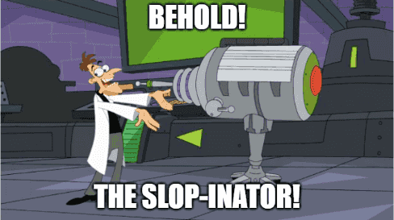
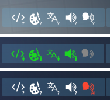

	

    
 

A Chrome/Firefox extension to show the Generative AI usage on public apps, especially on Steam games.  
This will be shown like that:   

# Installation

**Chrome web store (Chrome/Opera):** https://chromewebstore.google.com/detail/slop-inator/hgflafbjgbapndncdllnmkefinafckoj  
**Firefox addon store:** https://addons.mozilla.org/fr/firefox/addon/slop-inator/  
**On the Steam client:**
- Open the steam client, and go to the store
- Right click on any link then "Open link in new tab"
- Paste the extension url in the URI bar: https://chromewebstore.google.com/detail/slop-inator/hgflafbjgbapndncdllnmkefinafckoj
- Click "Add to Chrome"
- Click "Save" (it won't save it anywhere, but it works)
- Reload the steam client store page
- Enjoy!

Pre-release versions are also available in the "Releases" tab.  

# Details on the badges

## Badges

There are a few badges available generated by the extension
- Art: 2D Assets, Textures, 3D models, Animations, ... Any visual asset in the game/app
- Code: Anything related to programming the app/game
- Marketing: Text or pictures used on store pages, social medias, advertisement, ...
- Sound: VFX, music, ... but not voices
- Translation: translating from one language to another
- Voice: any voice in the game 

## Colors

- Green (human icon): Fully human made, no genai involved in the final result or in the process
- Orange (warning icon): Warning (unsure) or Past usage. Need to be reviewed/sourced more, or has been used in the past (e.g. placeholders replaced by human work. Art editing on top of AI work is not valid for this category)
- Red ("AI" icon): AI Usage
- White ("?" icon"): Unknown usage

# Support me

I do not plan to have any donation or revenue directly related to the browser extension.  
However, if you want to support me, check out my games on [Itch.io](https://elanis.itch.io) or [Steam](https://store.steampowered.com/developer/dysnomia).

# Contribution

You can add new data on Steam Games, or update them by editing the files or adding new files in [data/](data/).  
**Please make one Pull Request per game, and add sources URLs for any new data.**  
*Do not edit autogenerated files such as `steam_app_data.json`.*  
*No witch hunting please, we want facts, we want data with trusted sources!*

If you want to contribute to the extension code, please refer to the [Wxt Documentation](https://wxt.dev/guide/installation.html), and produce clear, understandable, maintenable code. One pull request per feature/bug fix is required.

# Privacy & Data shared

Your privacy is important. I will never recieve any of your data nor does any third party service. No telemetry is used.  
The only http calls are in the app are on the site itself (e.g: Steam calls steam, because I sometimes need data from another store page).  

# Licenses

This repository code is licensed under MIT.  

> MIT License
> 
> Copyright (c) 2026 Dysnomia, Elanis, and code contributors of this repository
> 
> Permission is hereby granted, free of charge, to any person obtaining a copy
> of this software and associated documentation files (the "Software"), to deal
> in the Software without restriction, including without limitation the rights
> to use, copy, modify, merge, publish, distribute, sublicense, and/or sell
> copies of the Software, and to permit persons to whom the Software is
> furnished to do so, subject to the following conditions:
> 
> The above copyright notice and this permission notice shall be included in all
> copies or substantial portions of the Software.
> 
> THE SOFTWARE IS PROVIDED "AS IS", WITHOUT WARRANTY OF ANY KIND, EXPRESS OR
> IMPLIED, INCLUDING BUT NOT LIMITED TO THE WARRANTIES OF MERCHANTABILITY,
> FITNESS FOR A PARTICULAR PURPOSE AND NONINFRINGEMENT. IN NO EVENT SHALL THE
> AUTHORS OR COPYRIGHT HOLDERS BE LIABLE FOR ANY CLAIM, DAMAGES OR OTHER
> LIABILITY, WHETHER IN AN ACTION OF CONTRACT, TORT OR OTHERWISE, ARISING FROM,
> OUT OF OR IN CONNECTION WITH THE SOFTWARE OR THE USE OR OTHER DEALINGS IN THE
> SOFTWARE.
  
The data on this respository are under Creative Commons Attribution-ShareAlike 4.0 International (CC BY-SA 4.0)  

> This license requires that reusers give credit to the creator. It allows reusers to distribute, remix, adapt, and build upon the material in any medium or format, even for commercial purposes. If others remix, adapt, or build upon the material, they must license the modified material under identical terms.
