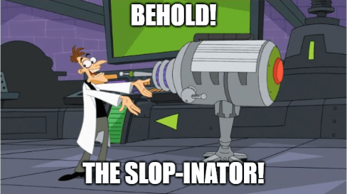
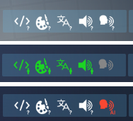

	

A chrome/firefox extension to show the Generative AI usage on public apps, especially on Steam games.  
This will be shown like that:   

# Installation

Chrome web store: TODO  
Firefox addon store: TODO  

Pre-release versions are also available in the "Releases" tab.  

# Support me

I do not plan to have any donation or revenue directly related to the browser extension.  
However, if you want to support me, check out my games on [Itch.io](https://elanis.itch.io) or [Steam](https://store.steampowered.com/developer/dysnomia).

# Contribution

You can add new data on Steam Games, or update them by editing [entrypoints/steam_app_data.json](entrypoints/steam_app_data.json).  
**Please make one Pull Request per game, and add sources URLs for any new data.** 

# Privacy & Data shared

Your privacy is important. So I decided that no server calls are being made by this extension. Every data is stored directly inside the bundled extension, and no telemetry is used.

# Licenses

This repository code is licensed under MIT.  

> MIT License
> 
> Copyright (c) 2026 Dysnomia, Elanis, and code contributors of this repository
> 
> Permission is hereby granted, free of charge, to any person obtaining a copy
> of this software and associated documentation files (the "Software"), to deal
> in the Software without restriction, including without limitation the rights
> to use, copy, modify, merge, publish, distribute, sublicense, and/or sell
> copies of the Software, and to permit persons to whom the Software is
> furnished to do so, subject to the following conditions:
> 
> The above copyright notice and this permission notice shall be included in all
> copies or substantial portions of the Software.
> 
> THE SOFTWARE IS PROVIDED "AS IS", WITHOUT WARRANTY OF ANY KIND, EXPRESS OR
> IMPLIED, INCLUDING BUT NOT LIMITED TO THE WARRANTIES OF MERCHANTABILITY,
> FITNESS FOR A PARTICULAR PURPOSE AND NONINFRINGEMENT. IN NO EVENT SHALL THE
> AUTHORS OR COPYRIGHT HOLDERS BE LIABLE FOR ANY CLAIM, DAMAGES OR OTHER
> LIABILITY, WHETHER IN AN ACTION OF CONTRACT, TORT OR OTHERWISE, ARISING FROM,
> OUT OF OR IN CONNECTION WITH THE SOFTWARE OR THE USE OR OTHER DEALINGS IN THE
> SOFTWARE.
  
The data on this respository are under Creative Commons Attribution-ShareAlike 4.0 International (CC BY-SA 4.0)  

> This license requires that reusers give credit to the creator. It allows reusers to distribute, remix, adapt, and build upon the material in any medium or format, even for commercial purposes. If others remix, adapt, or build upon the material, they must license the modified material under identical terms.